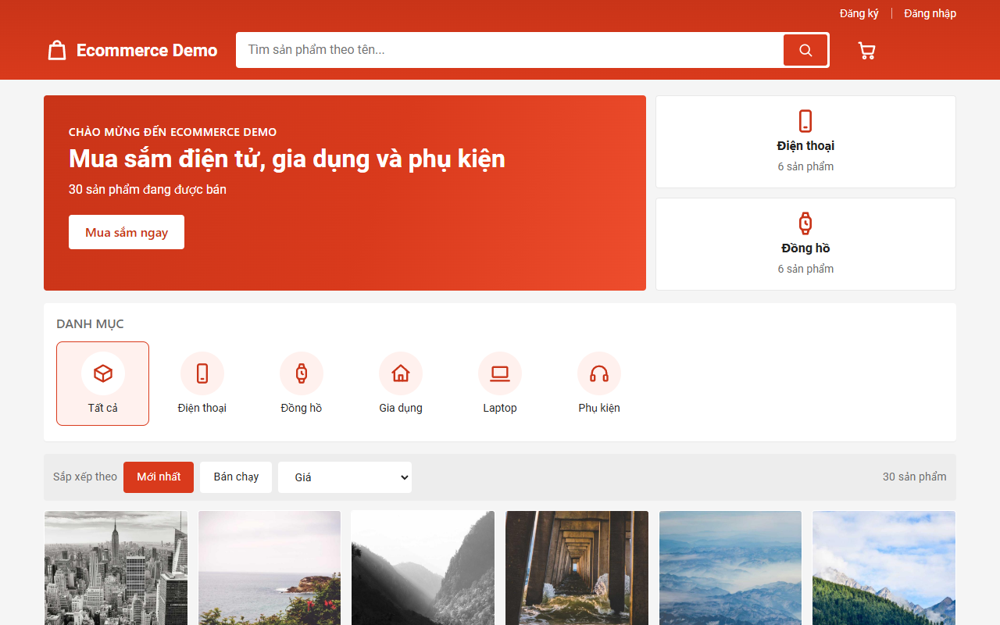
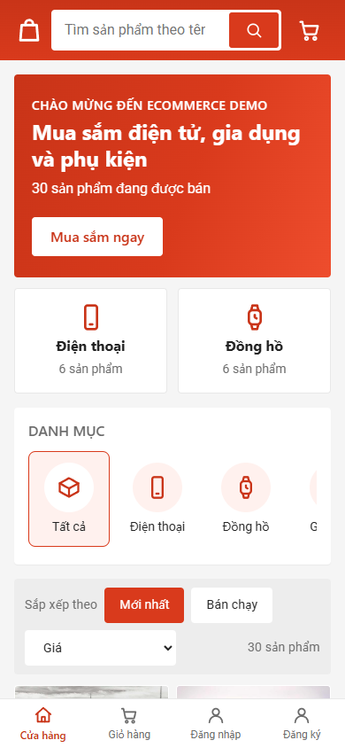
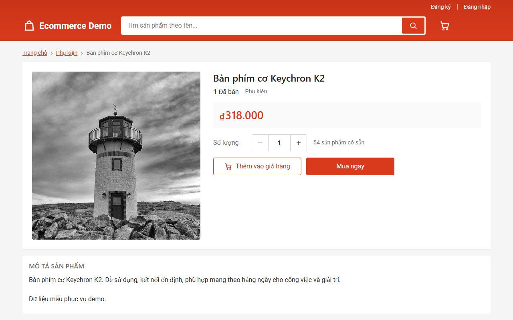
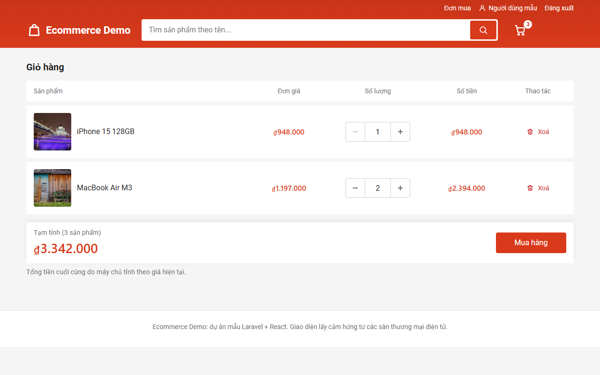
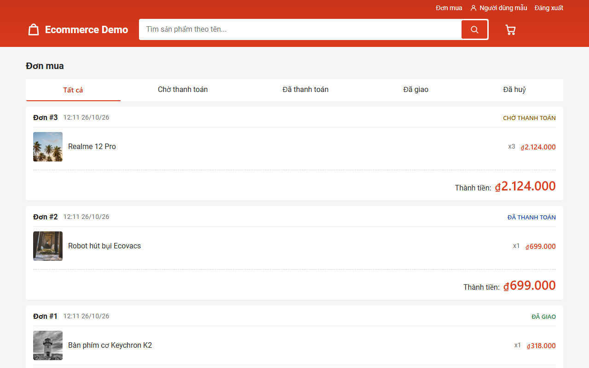
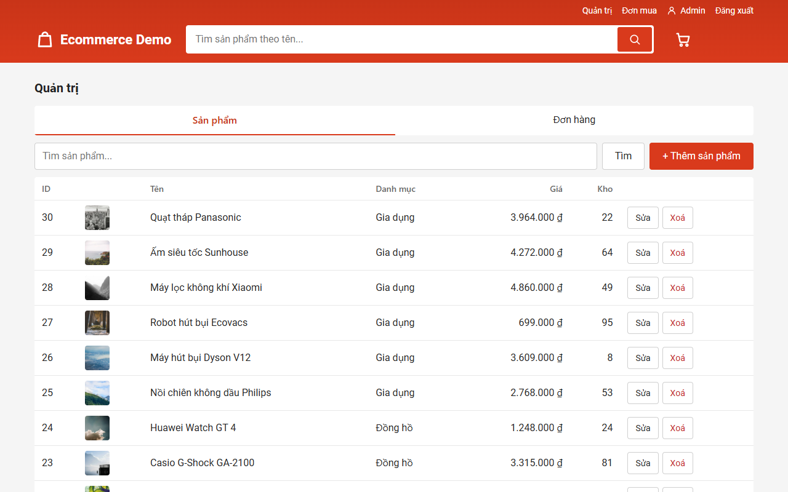
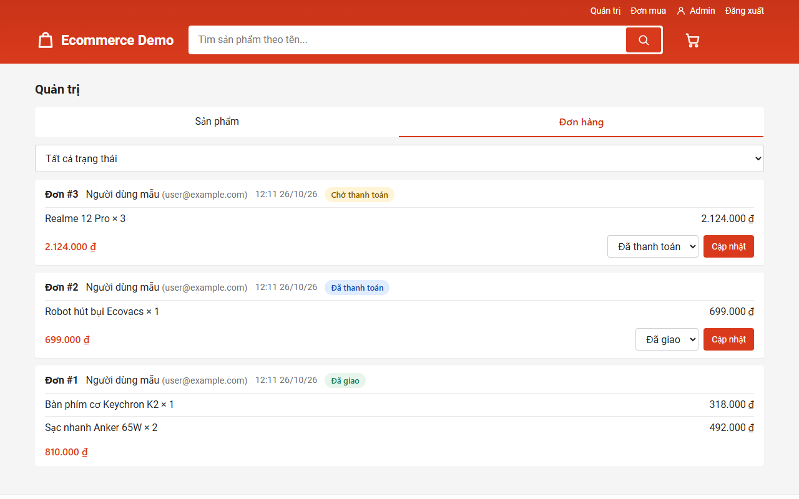
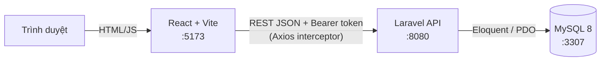
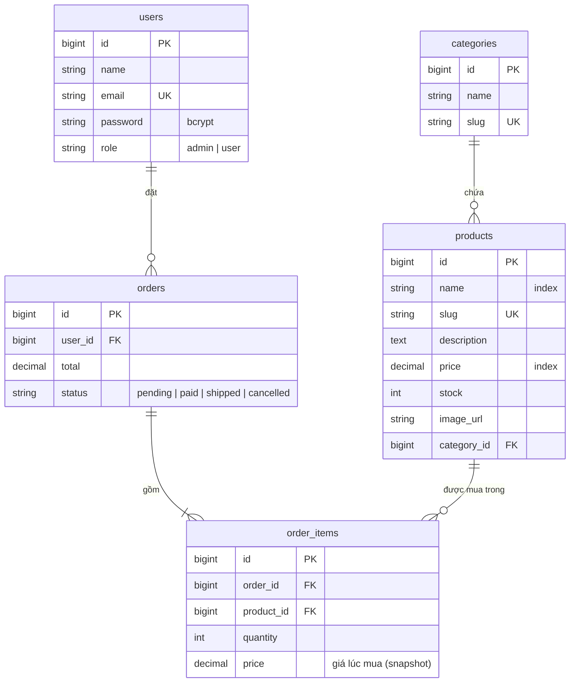

# Ecommerce Demo

<!-- Thay <USERNAME>/<REPO> bằng đường dẫn repo GitHub của bạn để badge hiển thị trạng thái CI -->


Website thương mại điện tử fullstack: khách xem và tìm sản phẩm, thêm vào giỏ, đặt hàng; admin quản lý sản phẩm và đơn hàng.
Dự án cá nhân phục vụ học tập và portfolio, tập trung vào những phần dễ sai trong thực tế: **xác thực và phân quyền, đặt hàng an toàn (transaction, chống bán lố), chống N+1, kiểm thử và CI**.

## Mục lục

[Ảnh chụp màn hình](#ảnh-chụp-màn-hình) · [Tính năng](#tính-năng) · [Tech stack](#tech-stack) · [Kiến trúc](#kiến-trúc) · [ERD](#sơ-đồ-erd) · [API](#danh-sách-api) · [Chạy bằng Docker](#chạy-bằng-docker) · [Tài khoản demo](#tài-khoản-demo) · [Test và CI](#test-và-ci) · [Bảo mật](#bảo-mật) · [Xử lý sự cố](#xử-lý-sự-cố)

## Ảnh chụp màn hình

> Các ảnh nằm trong [docs/screenshots/](docs/screenshots). **Muốn thay ảnh của bạn: chép đè lên file cùng tên**, hoặc sửa đường dẫn bên dưới.
> Muốn thêm ảnh mới: lưu vào `docs/screenshots/` rồi thêm dòng ``.

| Trang chủ (desktop) | Trang chủ (mobile) |
| :---: | :---: |
|  |  |

| Chi tiết sản phẩm | Giỏ hàng |
| :---: | :---: |
|  |  |

| Lịch sử đơn hàng | Admin: sản phẩm |
| :---: | :---: |
|  |  |

| Admin: đơn hàng |
| :---: |
|  |

## Tính năng

**Khách hàng**
- Giao diện kiểu sàn thương mại điện tử, responsive mobile-first (xem [design system](design-system/ecommerce-demo/MASTER.md)): banner, danh mục có icon, lưới 2-6 cột, thanh điều hướng dưới cho điện thoại
- Tìm theo tên ở header, lọc theo danh mục, sắp xếp Mới nhất / Bán chạy / Giá, phân trang (bộ lọc nằm trên URL nên chia sẻ được link). "Đã bán" lấy từ đơn hàng thật, không tính đơn đã huỷ
- Giỏ hàng lưu trong `localStorage`, giữ nguyên sau khi tải lại trang
- Đăng ký, đăng nhập, đăng xuất bằng Bearer token (Laravel Sanctum)
- Đặt hàng, xem "Đơn mua" của mình và lọc theo trạng thái

**Quản trị**
- CRUD sản phẩm, CRUD danh mục (API)
- Xem mọi đơn hàng, lọc theo trạng thái, đổi trạng thái theo luồng hợp lệ `pending → paid → shipped` (huỷ được khi `pending/paid`, huỷ thì hoàn tồn kho)

**Kỹ thuật nổi bật**
- Đặt hàng trong một DB transaction: khoá dòng `SELECT ... FOR UPDATE`, kiểm tra tồn kho, trừ kho, giá và tổng tiền tính ở server (không tin client), lỗi thì rollback toàn bộ
- Chống N+1 bằng eager loading, có test đếm số câu SQL
- Phân quyền hai lớp: middleware `admin` cho khu quản trị, `Policy` cho quyền xem đơn (chống IDOR)
- Rate limit đăng nhập, CORS giới hạn đúng origin frontend, Form Request validate mọi đầu vào
- 55 test backend trên MySQL, GitHub Actions CI

## Tech stack

| Lớp | Công nghệ |
| --- | --- |
| Backend | Laravel 12, PHP 8.3, REST API, Eloquent ORM, Laravel Sanctum, API Resource, Form Request, Policy |
| Frontend | React 19, Vite, React Router, Axios, Context API (không dùng thư viện UI/CSS), CSS mobile-first, icon SVG tự vẽ |
| Thiết kế | Skill [UI/UX Pro Max](https://github.com/nextlevelbuilder/ui-ux-pro-max-skill) (MIT) trong `.claude/skills/`, design system ghi ở [design-system/](design-system/ecommerce-demo/MASTER.md) |
| Database | MySQL 8 |
| DevOps | Docker, Docker Compose, GitHub Actions, Dependabot |
| Chất lượng | PHPUnit, Laravel Pint (code style), Oxlint |

> Dự án dùng Laravel 12 thay vì 11: mọi bản Laravel 11.x đều bị Composer chặn do có advisory bảo mật chưa có bản vá (nhánh 11 đã hết hỗ trợ).

## Kiến trúc



```
.
├── backend/                  Laravel API
│   ├── app/Http/Controllers/Api/   Controller (Admin/ cho khu quản trị)
│   ├── app/Http/Requests/          Form Request: validate đầu vào
│   ├── app/Http/Resources/         API Resource: định dạng JSON đầu ra
│   ├── app/Http/Middleware/        EnsureUserIsAdmin
│   ├── app/Services/OrderService   Đặt hàng, đổi trạng thái, hoàn kho (transaction)
│   ├── app/Policies/               OrderPolicy
│   ├── app/Models, app/Enums/      Model và UserRole / OrderStatus
│   ├── database/                   migrations, factories, seeders
│   └── tests/Feature/              test Auth, Catalog, Admin, Order
├── frontend/src/
│   ├── api/                  Axios client + interceptor, các lời gọi API
│   ├── context/              AuthProvider, CartProvider
│   ├── hooks/useApi.js       tải dữ liệu, loading/error, huỷ request cũ
│   ├── components/           Layout, ProtectedRoute, Pagination, ...
│   └── pages/                các trang (pages/admin cho quản trị)
├── design-system/            Quyết định thiết kế giao diện (màu, bố cục, thành phần)
├── .claude/skills/           Skill UI/UX Pro Max (dữ liệu + script tra cứu hướng dẫn thiết kế)
├── docs/                     ERD, tài liệu API, ảnh chụp màn hình
├── .github/workflows/ci.yml  GitHub Actions
└── docker-compose.yml        mysql + backend + frontend
```

## Sơ đồ ERD



Chi tiết quan hệ, hành vi khi xoá và danh sách index: [docs/ERD.md](docs/ERD.md).

## Danh sách API

Base URL: `http://localhost:8080/api`. Endpoint cần đăng nhập dùng header `Authorization: Bearer <token>` và `Accept: application/json`.

| Method | Endpoint | Quyền | Mô tả |
| --- | --- | --- | --- |
| GET | `/health` | công khai | Kiểm tra API và kết nối MySQL |
| POST | `/register` | công khai | Đăng ký, trả user và token |
| POST | `/login` | công khai | Đăng nhập (giới hạn 5 lần/phút theo email + IP) |
| POST | `/logout` | đăng nhập | Thu hồi token hiện tại |
| GET | `/me` | đăng nhập | Thông tin người dùng hiện tại |
| GET | `/products` | công khai | Query: `search`, `category` (slug), `sort` (`newest`, `best_selling`, `price_asc`, `price_desc`), `per_page`, `page`. Mỗi sản phẩm có `sold_count` |
| GET | `/products/{id}` | công khai | Chi tiết sản phẩm |
| GET | `/categories` | công khai | Danh mục kèm số sản phẩm |
| POST | `/orders` | đăng nhập | Đặt hàng: `{"items": [{"product_id": 1, "quantity": 2}]}` |
| GET | `/orders` | đăng nhập | Đơn hàng của tôi, lọc `?status=` |
| GET | `/orders/{id}` | chủ đơn hoặc admin | Chi tiết đơn |
| POST | `/admin/products` | admin | Tạo sản phẩm |
| PUT/PATCH | `/admin/products/{id}` | admin | Sửa sản phẩm |
| DELETE | `/admin/products/{id}` | admin | Xoá (409 nếu đã có trong đơn hàng) |
| POST, PUT/PATCH, DELETE | `/admin/categories[/{id}]` | admin | CRUD danh mục (xoá trả 409 nếu còn sản phẩm) |
| GET | `/admin/orders` | admin | Mọi đơn hàng, lọc `?status=` |
| PATCH | `/admin/orders/{id}/status` | admin | Đổi trạng thái: `{"status": "paid"}` |

Mã lỗi: `401` chưa đăng nhập, `403` không đủ quyền, `404` không tồn tại, `409` xung đột dữ liệu, `422` dữ liệu không hợp lệ (kèm `errors`), `429` vượt giới hạn.
Chi tiết: [docs/AUTH_API.md](docs/AUTH_API.md) và [docs/SHOP_API.md](docs/SHOP_API.md).

## Chạy bằng Docker

**Yêu cầu:** Docker Desktop đang chạy (Windows 10/11). Không cần cài PHP, Composer hay Node trên máy.

```powershell
git clone <URL-repo-cua-ban> ecommerce-demo
cd ecommerce-demo

docker compose up --build -d                                  # lần đầu mất vài phút (cài package)
docker compose exec backend php artisan migrate:fresh --seed  # tạo bảng + dữ liệu mẫu
```

| Service | URL |
| --- | --- |
| Frontend | http://localhost:5173 |
| API | http://localhost:8080/api/health |
| MySQL | `localhost:3307` (user `ecommerce`, mật khẩu `secret`, database `ecommerce`) |

File `backend/.env` và `frontend/.env` được tự tạo từ `.env.example` ở lần chạy đầu. **Không commit file `.env`** (đã nằm trong `.gitignore`).
Đổi cổng hoặc mật khẩu MySQL: copy `.env.example` ở thư mục gốc thành `.env` rồi sửa.

Lệnh thường dùng:

```powershell
docker compose ps                                   # trạng thái các service
docker compose logs -f backend                      # xem log (hoặc frontend, mysql)
docker compose exec backend php artisan route:list --path=api
docker compose restart frontend                     # sau khi sửa frontend/.env (Vite chỉ đọc env lúc khởi động)
docker compose down                                 # dừng, giữ dữ liệu
docker compose down -v                              # dừng và XOÁ dữ liệu DB, vendor, node_modules
```

## Tài khoản demo

Sau khi chạy `migrate:fresh --seed`:

| Vai trò | Email | Mật khẩu |
| --- | --- | --- |
| Admin | `admin@example.com` | `password` |
| Người dùng | `user@example.com` | `password` |

Dữ liệu mẫu: 5 danh mục, 30 sản phẩm. Đây là tài khoản chỉ dành cho môi trường dev, không dùng khi triển khai thật.

## Test và CI

```powershell
docker compose exec backend php artisan test                 # 55 test (mặc định chạy trên SQLite in-memory, rất nhanh)
docker compose exec backend ./vendor/bin/pint --test        # kiểm tra code style
docker compose exec frontend npm run lint
docker compose exec frontend npm run build
```

Chạy test trên **MySQL** (giống CI), dùng database riêng để không đụng dữ liệu dev:

```powershell
docker compose exec mysql mysql -uroot -proot -e "CREATE DATABASE IF NOT EXISTS ecommerce_test; GRANT ALL ON ecommerce_test.* TO 'ecommerce'@'%'; FLUSH PRIVILEGES;"
docker compose exec -e DB_CONNECTION=mysql -e DB_DATABASE=ecommerce_test backend php artisan test
```

**GitHub Actions** ([.github/workflows/ci.yml](.github/workflows/ci.yml)) chạy khi `push` và `pull_request`:

| Job | Các bước |
| --- | --- |
| Backend | PHP 8.3, service MySQL 8 → `composer install` → Pint → PHPUnit trên MySQL |
| Frontend | Node 22 → `npm ci` → `npm run lint` → `npm run build` |

Dependabot ([.github/dependabot.yml](.github/dependabot.yml)) mở pull request nâng cấp package mỗi tuần.

## Bảo mật

| Nguy cơ | Cách xử lý |
| --- | --- |
| SQL Injection | Eloquent/Query Builder bind tham số qua PDO; `sort` dùng whitelist; ký tự `%` `_` khi tìm kiếm được escape |
| XSS | API chỉ trả JSON; React tự escape, không dùng `dangerouslySetInnerHTML`; `image_url` chỉ nhận http/https |
| CSRF | Xác thực bằng header `Authorization: Bearer`, không dùng cookie nên trình duyệt không tự gửi kèm |
| Lộ mật khẩu | Băm bcrypt; `password` luôn bị ẩn khỏi JSON; thông báo đăng nhập sai không tiết lộ email có tồn tại |
| Mass assignment | `role` không nằm trong `$fillable`, không thể tự đăng ký làm admin |
| Dò mật khẩu | Rate limit đăng nhập; token tự hết hạn sau 7 ngày |
| Truy cập trái phép | Middleware `admin`; `OrderPolicy` chống IDOR (đổi id để xem đơn người khác) |
| Giả mạo giá | Đơn hàng chỉ nhận `product_id` và `quantity`, giá và tổng tiền tính ở server |

Giải thích chi tiết: [docs/AUTH_API.md](docs/AUTH_API.md).

## Xử lý sự cố

| Triệu chứng | Cách xử lý |
| --- | --- |
| `failed to connect to the docker API` | Mở Docker Desktop và đợi nó khởi động xong |
| `port is already allocated` | Cổng bị chiếm. Copy `.env.example` thành `.env` ở thư mục gốc rồi đổi `BACKEND_PORT` / `FRONTEND_PORT` / `MYSQL_PORT` |
| Trang chủ trống, console báo CORS | `frontend/.env` đang trỏ sai cổng API. Sửa `VITE_API_URL` cho khớp `BACKEND_PORT` rồi `docker compose restart frontend` |
| Đăng nhập báo "thao tác quá nhanh" (429) | Rate limit 5 lần/phút theo email. Đợi một phút |
| `composer install` / `npm install` chậm hoặc lỗi file khoá | Dự án đang nằm trong thư mục được OneDrive đồng bộ. Chuyển ra ngoài (ví dụ `C:\dev`) hoặc tạm dừng đồng bộ |
| Sửa code frontend không tự cập nhật | Đã bật polling cho Docker trên Windows. Nếu vẫn không được, `docker compose restart frontend` |

## Hạn chế và hướng phát triển

- Chưa có thanh toán thật: trạng thái `paid` do admin đổi tay
- Người dùng chưa tự huỷ đơn; admin chưa có màn hình quản lý danh mục (API đã có)
- Tìm kiếm dùng `LIKE '%...%'` nên không dùng được index; dữ liệu lớn nên chuyển sang FULLTEXT hoặc Scout
- Token lưu ở `localStorage` (đơn giản nhưng rủi ro nếu có XSS); có thể chuyển sang cookie `HttpOnly` (Sanctum SPA) kèm bảo vệ CSRF
- Docker hiện cho môi trường phát triển (`php artisan serve`, Vite dev server); bản production cần image đa tầng với php-fpm và nginx
- Chưa có test frontend tự động
