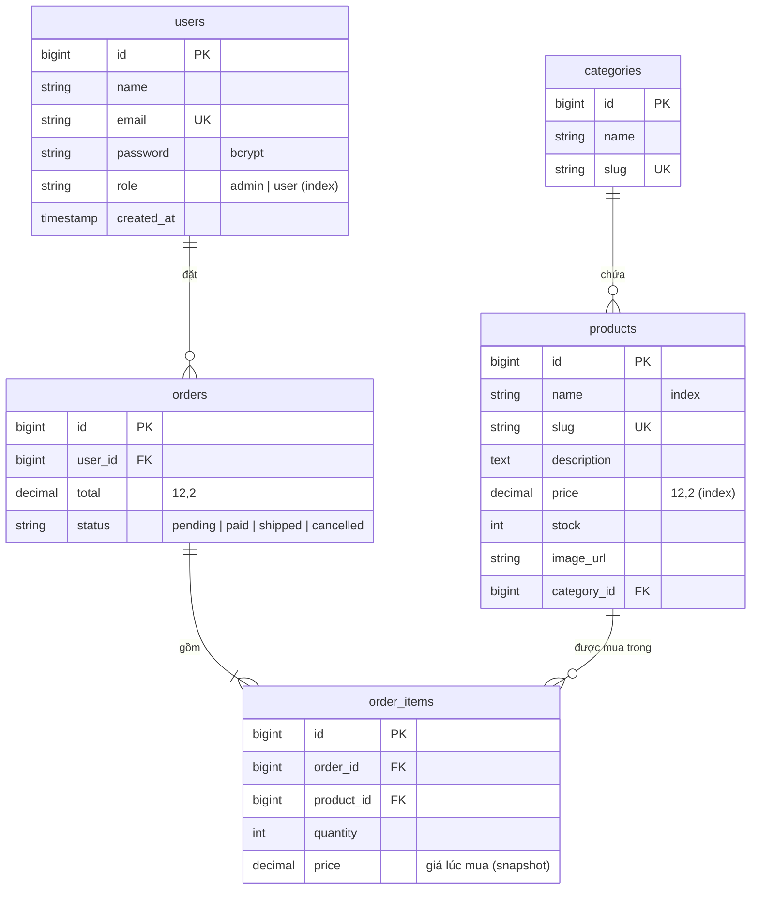

# Sơ đồ ERD

GitHub tự render khối mermaid bên dưới. Trong VS Code, cài extension "Markdown Preview Mermaid Support" để xem.

## Quan hệ và hành vi khi xoá

| Quan hệ | Loại | Khi xoá bản ghi cha |
| --- | --- | --- |
| `categories` 1 - N `products` | hasMany / belongsTo | **restrict**: không xoá được danh mục còn sản phẩm |
| `users` 1 - N `orders` | hasMany / belongsTo | **restrict**: giữ lịch sử đơn hàng |
| `orders` 1 - N `order_items` | hasMany / belongsTo | **cascade**: xoá đơn thì xoá các dòng chi tiết |
| `products` 1 - N `order_items` | hasMany / belongsTo | **restrict**: không xoá sản phẩm đã từng được bán |
| `orders` N - N `products` | belongsToMany qua `order_items` | - |

## Index

| Bảng | Index | Phục vụ truy vấn |
| --- | --- | --- |
| users | `email` (unique), `role` | đăng nhập, lọc admin |
| categories | `slug` (unique) | lấy danh mục theo URL |
| products | `slug` (unique), `name`, `price`, `category_id` | trang chi tiết, tìm kiếm tiền tố, sắp xếp/lọc giá, lọc theo danh mục |
| orders | `(user_id, status)`, `(status, created_at)` | "đơn của tôi", danh sách đơn theo trạng thái ở trang admin |
| order_items | `(order_id, product_id)` (unique), `product_id` | lấy dòng của đơn, chặn trùng sản phẩm trong đơn |
