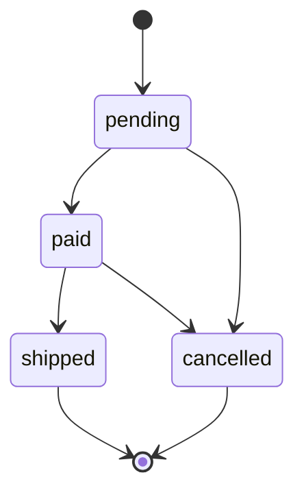

# Catalog và Order API

Base URL: `http://localhost:8080/api`. Mọi endpoint (trừ công khai) cần `Authorization: Bearer <token>` và `Accept: application/json`.
Danh sách có phân trang trả `{data, links, meta}`; một đối tượng trả `{data: {...}}`. Tiền là chuỗi thập phân (`"199000.00"`).

## Công khai

| Method | Endpoint | Mô tả |
| --- | --- | --- |
| GET | `/products` | Query: `search` (tên), `category` (slug), `sort` = `newest` (mặc định), `best_selling`, `price_asc` hoặc `price_desc`, `per_page` (1-50, mặc định 12), `page`. Mỗi sản phẩm có `sold_count` (tổng số lượng đã bán, không tính đơn đã huỷ) |
| GET | `/products/{id}` | Chi tiết sản phẩm kèm danh mục |
| GET | `/categories` | Danh mục kèm `products_count` |

## Người dùng đăng nhập

| Method | Endpoint | Mô tả |
| --- | --- | --- |
| POST | `/orders` | Body: `{"items": [{"product_id": 1, "quantity": 2}]}`. Chỉ gửi id và số lượng; giá và tổng tiền do server tính. Tối đa 30 lần/phút. |
| GET | `/orders` | Đơn hàng của tôi (10 đơn/trang, mới nhất trước). Lọc theo trạng thái bằng `?status=` (`pending`, `paid`, `shipped` hoặc `cancelled`) |
| GET | `/orders/{id}` | Chi tiết đơn. Chỉ chủ đơn hoặc admin (OrderPolicy), người khác nhận 403 |

Lỗi đặt hàng: hết hàng trả 422 với `errors["items.N.quantity"]`; toàn bộ đơn bị rollback, không trừ kho sản phẩm nào.

## Admin (`auth:sanctum` + middleware `admin`)

| Method | Endpoint | Mô tả |
| --- | --- | --- |
| POST | `/admin/products` | Tạo sản phẩm (không gửi `slug` thì tự sinh) |
| PUT/PATCH | `/admin/products/{id}` | Sửa sản phẩm (gửi đủ các trường bắt buộc) |
| DELETE | `/admin/products/{id}` | Xoá. 409 nếu sản phẩm đã có trong đơn hàng |
| POST, PUT/PATCH, DELETE | `/admin/categories[/{id}]` | CRUD danh mục. Xoá trả 409 nếu còn sản phẩm |
| GET | `/admin/orders?status=` | Tất cả đơn hàng kèm người đặt |
| PATCH | `/admin/orders/{id}/status` | Body: `{"status": "paid"}` |

## Luồng trạng thái đơn hàng

Chuyển sang `cancelled` thì hoàn lại tồn kho. Chuyển trạng thái không hợp lệ trả 422.

## Đặt hàng an toàn như thế nào

1. Toàn bộ nằm trong một `DB::transaction`: lỗi ở đâu cũng rollback hết.
2. `SELECT ... FOR UPDATE` (`lockForUpdate`) trên các sản phẩm, khoá theo thứ tự id tăng dần: chống bán lố khi nhiều người mua cùng lúc và tránh deadlock.
3. Giá lấy từ DB, tính tổng bằng số nguyên "xu"; `order_items.price` lưu giá lúc mua.
4. Cột `stock` là `UNSIGNED`: ngay cả khi code sai, DB không cho tồn kho âm.
